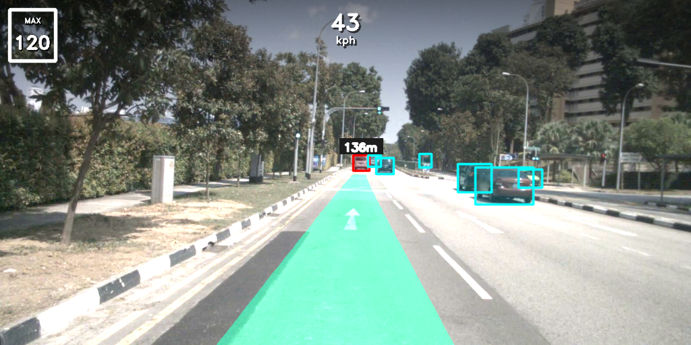
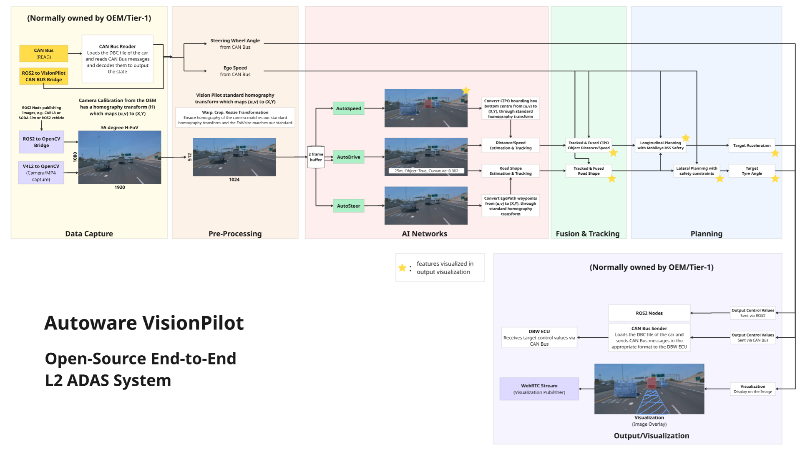

# Vision Pilot — CAN Open

Vision-only, end-to-end **L2 ADAS** for cars with an open CAN bus. A single forward camera
feeds three ONNX networks; their outputs are fused, tracked, and turned into steering and
acceleration commands by an MPC planner. Runs on a laptop-class GPU at ~25–30 fps.



The HUD: ego speed in **kph** (top centre), configured speed limit badge (top left), planned
path corridor in green, detected objects in cyan, closest in-path object (CIPO) in red with
its distance.

> **Not a self-driving system.** Open-loop by default, and never a substitute for an
> attentive driver. Read [DISCLAIMER.md](DISCLAIMER.md) before putting this in a vehicle.

## Contents

- [How it works](#how-it-works)
- [Repository layout](#repository-layout)
- [Requirements](#requirements)
- [Setup](#setup)
- [Running](#running)
- [Configuration](#configuration)
- [Switching model precision (fp32 ↔ int8)](#switching-model-precision-fp32--int8)
- [Docker](#docker)
- [Camera calibration](#camera-calibration)
- [Simulation](#simulation)
- [Tests](#tests)
- [Troubleshooting](#troubleshooting)
- [Further reading](#further-reading)
- [Contributing](#contributing)

## How it works



```text
camera (V4L2 | video file | ROS 2)        vehicle speed (CAN | file | ROS 2)
              │                                        │
              ▼                                        │
  image_preprocessing — warps the frame through the     │
  C matrix into the canonical 1024x512 bird's-eye view  │
              │                                        │
              ▼                                        ▼
     ┌────────────── inference (3 ONNX models, concurrent) ──────────────┐
     │  AutoDrive   two-frame: CIPO distance, relative velocity, curve   │
     │  AutoSteer   ego path / lane geometry                             │
     │  AutoSpeed   in-path object detection                             │
     └────────────────────────────────┬──────────────────────────────────┘
                                      ▼
             safety_guardian/fusion — longitudinal + lateral fusion,
             target tracking, FCW / AEB / lane-departure warnings
                                      ▼
             safety_guardian/planning — IPOPT + CppAD MPC producing a
             tyre angle and an acceleration command
                                      ▼
             visualization (HUD window and/or WebRTC)  ·  vehicle interface
```

The `H` matrix (image pixels → world metres, X forward / Y left, origin at the front bumper)
is never read by the networks directly. `scripts/find_homography_C_matrix.py` combines it with
the fixed model-view matrix `V` into a **C matrix**, and the preprocessor warps every frame
through C. Getting `H` right is what makes distances and lane geometry line up.

## Repository layout

| Path                                                                       | What it is                                                          |
| -------------------------------------------------------------------------- | ------------------------------------------------------------------- |
| [VisionPilot/](VisionPilot/)                                               | The stack itself — C++ app, modules, models, configs, scripts       |
| [VisionPilot/app/](VisionPilot/app/)                                       | `vision_pilot.cpp` — the main loop                                  |
| [VisionPilot/modules/](VisionPilot/modules/)                               | Sensing, engine, models, fusion, planning, visualization, logging   |
| [VisionPilot/modules/models/weights/](VisionPilot/modules/models/weights/) | Shipped ONNX weights, fp32 and int8                                 |
| [VisionPilot/config/](VisionPilot/config/)                                 | Runtime config, camera homography, CAN DBC                          |
| [VisionPilot/tools/](VisionPilot/tools/)                                   | `build_trt_engines` — builds TensorRT engines one process at a time |
| [VisionPilot/scripts/](VisionPilot/scripts/)                               | `run_inference.sh`, nuScenes converter, C-matrix generator          |
| [VisionPilot/data/nuscenes/](VisionPilot/data/nuscenes/)                   | Three bundled nuScenes clips with speed tracks and calibration      |
| [VisionPilot/docker/](VisionPilot/docker/)                                 | GPU and CPU images plus `build.sh` / `run.sh`                       |
| [VisionPilot/docs/](VisionPilot/docs/)                                     | [nuScenes how-to (PDF)](VisionPilot/docs/nuscenes_howto.pdf)        |
| [Calibration/](Calibration/)                                               | Ground-checkerboard extrinsic calibration tool                      |
| [Sensing/](Sensing/)                                                       | Camera choice and mounting guide                                    |
| [Simulation/](Simulation/)                                                 | CARLA (ROS 2 / Zenoh) and SODA.Sim integration                      |

## Requirements

|                   |                                                                                                |
| ----------------- | ---------------------------------------------------------------------------------------------- |
| OS                | Ubuntu 22.04 or 24.04                                                                          |
| Toolchain         | CMake ≥ 3.22.1, a C++17 compiler                                                               |
| Core libs         | OpenCV 4, Ipopt (`coinor-libipopt-dev`), CppAD, LAPACK/BLAS                                    |
| Runtime           | ONNX Runtime 1.26+ — GPU build for CUDA, CPU build otherwise                                   |
| GPU (optional)    | NVIDIA driver + CUDA 12/13; cuDNN and TensorRT for the `tensorrt` provider                     |
| WebRTC (optional) | GStreamer 1.0 (+ `webrtc`, `nice`, `srtp` plugins), Boost.System, nlohmann/json                |
| ROS 2 (optional)  | Jazzy — `rclcpp`, `cv_bridge`, `image_transport`                                               |
| Python            | `python3` with `numpy` + `opencv-python` (C-matrix generator); `ffmpeg` for `run_inference.sh` |

A GPU is not strictly required — `engine.provider = cpu` works, just slowly.

## Setup

### 1. Clone

```bash
git clone --recurse-submodules https://github.com/adeirman46/Vision_Pilot_CAN_Open.git
cd Vision_Pilot_CAN_Open
```

Already cloned without submodules? `git submodule update --init --recursive`.

### 2. System dependencies

```bash
sudo apt update
sudo apt install -y build-essential cmake git wget ffmpeg \
    python3 python3-numpy python3-opencv \
    libopencv-dev coinor-libipopt-dev libcppad-dev liblapack-dev libblas-dev

# Optional — WebRTC streaming instead of a local window
sudo apt install -y libgstreamer1.0-dev libgstreamer-plugins-base1.0-dev \
    libgstreamer-plugins-bad1.0-dev gstreamer1.0-plugins-good \
    gstreamer1.0-plugins-bad gstreamer1.0-nice libnice-dev libsrtp2-dev \
    libboost-system-dev nlohmann-json3-dev
```

CppAD's `cppad/ipopt/solve.hpp` includes `<coin-or/...>`, but Ubuntu ships the Ipopt headers
in `/usr/include/coin`. Symlink it once:

```bash
sudo ln -sfn /usr/include/coin /usr/include/coin-or
```

On a GPU machine also install the CUDA runtime pieces ONNX Runtime needs — for CUDA 12.8:

```bash
sudo apt install -y libcudnn9-cuda-12 libcufft-12-8 libcurand-12-8 && sudo ldconfig
```

### 3. ONNX Runtime

Download a release matching your CUDA major version and unpack it anywhere; the path is passed
to CMake, not installed system-wide.

```bash
ORT=1.27.1
wget https://github.com/microsoft/onnxruntime/releases/download/v${ORT}/onnxruntime-linux-x64-gpu_cuda12-${ORT}.tgz
mkdir -p ~/onnxruntime && tar -xzf onnxruntime-linux-x64-gpu_cuda12-${ORT}.tgz -C ~/onnxruntime
```

For a CPU-only machine take the `onnxruntime-linux-x64-${ORT}.tgz` asset instead and configure
with `-DGPU=OFF`.

### 4. Build

Build **in `VisionPilot/build`** — `scripts/find_homography_C_matrix.py` resolves
`../config/H.yaml` relative to the build directory, and the binary looks for `config/` and
`modules/models/weights/` relative to its working directory.

```bash
cd VisionPilot
mkdir -p build && cd build
cmake -DONNXRUNTIME_ROOT=$HOME/onnxruntime/onnxruntime-linux-x64-gpu_cuda12-1.27.1 \
      -DGPU=ON -DCMAKE_BUILD_TYPE=Release \
      -DCMAKE_CXX_STANDARD_LIBRARIES="-lcppad_lib" ..
make -j$(nproc)
```

| CMake option            | Default | Meaning                                       |
| ----------------------- | ------- | --------------------------------------------- |
| `ONNXRUNTIME_ROOT`      | —       | **Required.** Unpacked ONNX Runtime directory |
| `GPU`                   | `ON`    | Link the CUDA/TensorRT-capable runtime        |
| `ENABLE_ROS2_INTERFACE` | `OFF`   | Camera and vehicle I/O over ROS 2 topics      |
| `BUILD_TESTING`         | `OFF`   | Declared, but `tests/` builds either way      |

Configure-time side effects worth knowing: `config/` is copied to `build/config/`, the weights
are copied to `build/modules/models/weights/`, and `build/config/homography_C_matrix.yaml` is
regenerated from `config/H.yaml` on every build. WebRTC is compiled in only when GStreamer,
Boost.System and nlohmann/json are all found — otherwise CMake warns and the local OpenCV
window is used instead.

### 5. First run

```bash
cd VisionPilot/scripts
./run_inference.sh scene-0796
```

## Running

### On the bundled nuScenes clips

```bash
cd VisionPilot/scripts
./run_inference.sh scene-0796                             # clean HUD window
./run_inference.sh scene-1077 -- --debug-viz              # telemetry overlay
./run_inference.sh scene-0655 --fast -- --no-window       # headless, no frame pacing
./run_inference.sh /path/to/dashcam.mp4 --speed-const 25  # your own footage
```

A bare clip name resolves against [VisionPilot/data/nuscenes/](VisionPilot/data/nuscenes/); any
other argument is treated as a path.

| Option                | Meaning                                                                               |
| --------------------- | ------------------------------------------------------------------------------------- |
| `--speed <file>`      | Speed track, one value in m/s per frame. Default `<video>_speed.txt` beside the video |
| `--speed-const <m/s>` | Synthesise a constant track when no file exists (default 15)                          |
| `--calib <H.yaml>`    | Camera homography. Default `<video>_H.yaml` beside the video                          |
| `--loop`              | Replay the clip continuously                                                          |
| `--fast`              | Ignore the video frame rate, run as fast as the GPU allows                            |
| `-- <args>`           | Everything after `--` goes to the binary: `--debug-viz`, `--no-window`                |

The script installs the chosen `H.yaml` into `config/`, regenerates the C matrix, writes
`build/config/vision_pilot_test.conf`, pads a short speed track, then execs the binary from
`build/`. `./run_inference.sh --help` prints the same list.

### Directly

The binary resolves `config/` and `modules/models/weights/` relative to the working directory,
so run it from the build directory:

```bash
cd VisionPilot/build
./VisionPilot                # HUD window
./VisionPilot --no-window    # console only
./VisionPilot --debug-viz    # annotated telemetry overlay
```

### On a vehicle or a live camera

Set `source.mode = v4l2` in [VisionPilot/config/vision_pilot.conf](VisionPilot/config/vision_pilot.conf)
and point `source.v4l2_device` at the camera. Read [Sensing/README.md](Sensing/README.md) for
camera choice and mounting, and calibrate before trusting any distance on screen.

> **The CAN path is still a stub.** In `v4l2` mode the vehicle interface is
> `modules/sensing/vehicle_interface/src/can_interface.cpp`, whose `read()` returns `0.0` and
> whose `write()` does nothing — so ego speed reads as zero and no command reaches the bus.
> [VisionPilot/config/vehicle.dbc](VisionPilot/config/vehicle.dbc) ships for that integration
> but nothing decodes it yet. Wiring SocketCAN up is the open work behind this fork's name.
> The ROS 2 interface, by contrast, is implemented: it subscribes to `vehicle_speed_topic` and
> publishes steering and acceleration commands.

## Configuration

Three plain `key = value` files in [VisionPilot/config/](VisionPilot/config/), all resolved as
`config/<name>` relative to the working directory, falling back to
`/usr/share/visionpilot/config/<name>`:

| File                     | When it is read                                                 |
| ------------------------ | --------------------------------------------------------------- |
| `vision_pilot.conf`      | Always                                                          |
| `vision_pilot_test.conf` | Only when `source.mode = video` (written by `run_inference.sh`) |
| `vision_pilot_ros2.conf` | Only in a build with `ENABLE_ROS2_INTERFACE=ON`                 |

Because CMake copies `config/` into `build/config/` at configure time, **the copy the binary
reads is `build/config/`**. Edit that for a one-off change, or edit the source config and
refresh the copy:

```bash
cd VisionPilot/build && cmake ..     # re-copies config/ into build/config/
# or just: cp ../config/vision_pilot.conf config/
```

### `vision_pilot.conf`

| Key                   | Default                      | Meaning                                                                         |
| --------------------- | ---------------------------- | ------------------------------------------------------------------------------- |
| `source.mode`         | `video`                      | `video`, `v4l2` or `ros2`                                                       |
| `source.v4l2_device`  | `/dev/video0`                | Camera device in `v4l2` mode                                                    |
| `source.v4l2_fps`     | `10`                         | Capture rate in `v4l2` mode                                                     |
| `engine.provider`     | `cpu`                        | `cpu`, `cuda` or `tensorrt`                                                     |
| `engine.device_id`    | `0`                          | GPU index                                                                       |
| `engine.cache_dir`    | `/tmp/visionpilot_trt_cache` | TensorRT engine + timing cache                                                  |
| `engine.workspace_gb` | `1.0`                        | TensorRT workspace budget                                                       |
| `model.precision`     | `fp32`                       | `fp32` or `int8` — picks the weights file                                       |
| `speed_limit`         | —                            | **Required.** Target speed cap in m/s, and the `MAX` badge (33.3 m/s = 120 kph) |
| `Lf`                  | —                            | **Required.** Front axle to CoG in metres                                       |
| `fusion.debug`        | `false`                      | Verbose fusion logging                                                          |
| `fusion.cte_bias_m`   | `0.0`                        | Constant cross-track-error offset                                               |
| `visualization_on`    | `false`                      | Render the HUD at all                                                           |
| `webrtc_on`           | `false`                      | Stream over WebRTC instead of an OpenCV window                                  |
| `webrtc_port`         | `8080`                       | WebRTC signalling/HTTP port                                                     |
| `debug.wheel_dir`     | —                            | Steering-wheel assets for `--debug-viz`                                         |

`vision_pilot_test.conf` adds `source.input_video`, `source.input_vehicle_speed`,
`source.dataset`, `source.video_realtime` and `source.video_loop`. `vision_pilot_ros2.conf`
holds `source.input_camera_topic`, `vehicle_speed_topic`, `vehicle_steering_topic` and
`vehicle_acceleration_topic`.

## Switching model precision (fp32 ↔ int8)

The simplest way is the `run_inference.sh` flag:

```bash
cd VisionPilot/scripts
./run_inference.sh scene-0796 --precision default   # VisionPilot's fp32 weights
./run_inference.sh scene-0796 --precision int8      # quantised, picks tensorrt automatically
```

`--precision` rewrites `build/config/vision_pilot.conf` and prints what it selected; omit it
and the config is left exactly as it is. Measured on an RTX 4060 Laptop, scene-0796, 588
frames, median per-frame wall time with the TensorRT engines already cached:

| setup                               | wall        | AutoDrive | AutoSteer | AutoSpeed |
| ----------------------------------- | ----------- | --------- | --------- | --------- |
| `--precision default` (fp32, cuda)  | 42.0 ms     | 21.9      | 20.3      | 23.7      |
| `--precision int8` (int8, tensorrt) | **22.7 ms** | **14.6**  | **13.3**  | **14.4**  |

Each model runs about 1.5× faster. The end-to-end figure moves with the GPU's thermal state —
a cool-GPU fp32 run measured 29.4 ms wall — so treat the wall-clock gain as roughly 1.3–1.8×.

### int8 needs TensorRT

The ONNX Runtime CUDA provider has no int8 kernels: it dequantises the graph and runs fp32
math with quantisation overhead on top, measured at **57.1 ms**, twice as slow as plain fp32.
`--precision int8` therefore switches `engine.provider` to `tensorrt` for you, and it has to
stay there for int8 to mean anything.

### Regenerating the int8 weights

The int8 weights in
[VisionPilot/modules/models/weights/](VisionPilot/modules/models/weights/) come from
[VisionPilot/scripts/quantize_models.py](VisionPilot/scripts/quantize_models.py), which
calibrates on frames from the bundled clips put through exactly the same preprocessing as the
C++ pipeline:

```bash
cd VisionPilot/scripts
/usr/bin/python3 quantize_models.py                      # all three, MinMax calibration
/usr/bin/python3 quantize_models.py --models autospeed --frames 32
/usr/bin/python3 quantize_models.py --calibrate entropy  # alternative range estimator
```

Five properties are load-bearing. Miss one of the first three and TensorRT rejects the whole
graph and silently falls back to CUDA; miss one of the last two and the models load, run
fast, and quietly produce nonsense:

- **symmetric int8 zero points** — TensorRT refuses any `QuantizeLinear` whose zero point is
  not all zeros, which is exactly what the previously shipped uint8 weights had;
- **float biases** (`QuantizeBias: False`) — an INT32 bias `DequantizeLinear` is rejected;
- **Conv1d, Reshape-fed depthwise convs and the prediction head left in fp32** — TensorRT
  cannot fuse QDQ around the first two, and one bad node disqualifies the entire graph;
- **`op_types_to_quantize=["Conv"]`** — the graph's tail concatenates box coordinates
  (0–1021 px) with class probabilities (0–1) into a single tensor. Quantising that Concat
  gives it one scale of about 8, which rounds _every_ probability to zero: AutoSpeed then
  detects nothing at all while its boxes still look plausible;
- **ORT graph optimisations off for int8** (handled in `onnx_engine.cpp`) — otherwise ORT
  rewrites the QDQ pairs before TensorRT ever sees them.

The script prints `TensorRT-compatible` per model, which covers the first point only. Because
the remaining failure modes are silent, check the result before trusting it:

```bash
cd VisionPilot/build && ./build_trt_engines all   # must not print "No graph will run"
```

then run a clip and confirm cyan detection boxes still appear. A red CIPO marker with no cyan
boxes anywhere means AutoSpeed's scores collapsed.

### Per-model precision

Any of `model.precision.autodrive`, `.autosteer`, `.autospeed` overrides the global
`model.precision` — useful if one model ever fails to build as an int8 engine:

```ini
model.precision           = int8
model.precision.autodrive = fp32
```

### Building the engines without exhausting RAM

The first TensorRT run builds engines, and doing all three in one process peaked at **13 GB**
of host RAM here — enough to be OOM-killed on a 16 GB laptop. Build them one process at a
time instead:

```bash
cd VisionPilot/build
./build_trt_engines all         # or: ./build_trt_engines autosteer
```

That caps the peak at about 5 GB and caches the engines in `engine.cache_dir`, after which
runs start in seconds. int8 builds also drop to `trt_builder_optimization_level = 3`, since
level 5's tactic search is what drove the memory peak.

### Accuracy

On scene-0796 the int8 pipeline stays close to fp32: the CIPO flag agrees on **98.1%** of the
588 frames (an in-path object in 387 frames versus 386 for fp32), the distance to a shared
target differs by a median of **1.1 m**, and cross-track error by **0.036 m** on average. At
the model level, on four sample frames AutoSpeed returned 47 / 66 / 45 / 31 detections above
0.25 where fp32 returned 47 / 68 / 46 / 48 — close on most frames, noticeably thinner on
some, with peak scores within 0.03.

That is close, not identical. Validate on your own footage before relying on int8 for
anything safety-relevant, and keep fp32 as the reference when something looks wrong.

## Docker

```bash
cd VisionPilot/docker
./build.sh --gpu                             # or --cpu; add --ros2 for the ROS 2 variant
./run.sh --gpu                               # mounts config/, forwards $DISPLAY
./run.sh --gpu --data /host/clips:/data      # make footage visible in the container
./run.sh --cpu --v4l2 /dev/video0:/dev/video0
```

Images are tagged `visionpilot:{gpu,cpu}[-ros2]`. The GPU image needs
`nvidia-container-toolkit` on the host. `run.sh` bind-mounts the config files read-only, so
host-side edits apply to the next container run, and it publishes `webrtc_port` when
`webrtc_on = true`. Inside the image everything lives under `/usr/share/visionpilot/`.

## Camera calibration

Distances, the path corridor and lane geometry are only as good as `config/H.yaml`. To
calibrate your own camera, place four 2×2 ground checkerboards as described in
[Calibration/README.md](Calibration/README.md) and run:

```bash
cd Calibration
python3 calc_front_camera_homography.py
```

Copy the resulting matrix into [VisionPilot/config/H.yaml](VisionPilot/config/H.yaml) and
rebuild so the C matrix is regenerated. Convention: **X forward, Y left, metres, origin on the
ground at the centre of the front bumper.**

## Simulation

CARLA is supported over ROS 2 (preferred) and Zenoh (experimental); SODA.Sim is in progress.
See [Simulation/README.md](Simulation/README.md) and the per-simulator folders.

## Tests

[VisionPilot/tests/](VisionPilot/tests/) holds standalone diagnostic programs, not an
automated suite — they are built with the app and run by hand, and nothing is registered with
`ctest` yet.

```bash
cd VisionPilot/build
./test_planning                       # MPC visualiser: reference path vs predicted trajectory
./image_preprocessing_tests <image>   # warps one image through the C matrix
./test_vision_pilot                   # full pipeline against the current config
```

## Troubleshooting

| Symptom                                                            | Cause / fix                                                                     |
| ------------------------------------------------------------------ | ------------------------------------------------------------------------------- |
| `[engine] ONNXRUNTIME_ROOT is not set`                             | Pass `-DONNXRUNTIME_ROOT=<unpacked ORT dir>` to CMake                           |
| `fatal error: coin-or/IpIpoptApplication.hpp: No such file`        | `sudo ln -sfn /usr/include/coin /usr/include/coin-or`                           |
| `undefined reference to cppad_...`                                 | Configure with `-DCMAKE_CXX_STANDARD_LIBRARIES="-lcppad_lib"`                   |
| `Failed to load libonnxruntime_providers_cuda.so … libcufft.so.11` | `sudo apt install libcufft-12-8 libcurand-12-8 && sudo ldconfig`                |
| `Config file not found: vision_pilot.conf`                         | Run the binary from `VisionPilot/build`, not from the source root               |
| `Config file not found: autodrive_<x>.onnx`                        | `model.precision` must be `fp32` or `int8`                                      |
| `numpy.linalg.LinAlgError: 0-dimensional array given` during build | The C-matrix script needs `../config/H.yaml` — build inside `VisionPilot/build` |
| `FileInterface: read() called past end of speeds data`             | Speed track shorter than the clip; use `run_inference.sh`, which pads it        |
| Path or lane overlay at the wrong distance                         | `H.yaml` does not match the camera — pass `--calib` or recalibrate              |
| No window appears                                                  | `DISPLAY` unset (e.g. over SSH). Use `--no-window`, or export a display         |
| A config change is ignored                                         | You edited `config/` but the binary reads `build/config/`                       |

## Further reading

- [nuScenes how-to (PDF)](VisionPilot/docs/nuscenes_howto.pdf) — clip conversion, per-scene
  calibration, latency numbers, caveats
- [VisionPilot/data/nuscenes/README.md](VisionPilot/data/nuscenes/README.md) — the bundled clips
- [VisionPilot/modules/visualization/README.md](VisionPilot/modules/visualization/README.md) —
  WebRTC streaming design
- [Sensing/README.md](Sensing/README.md) · [Calibration/README.md](Calibration/README.md) ·
  [Simulation/README.md](Simulation/README.md)

## Contributing

[CONTRIBUTING.md](CONTRIBUTING.md) covers the workflow and coding standards;
[ONBOARDING.md](ONBOARDING.md) points at the Autoware Foundation Privately Owned Vehicle
working group, and [CODE_OF_CONDUCT.md](CODE_OF_CONDUCT.md) applies to every interaction.
Install the hooks before your first commit:

```bash
pip install pre-commit && pre-commit install
```

## License

[MIT](LICENSE). Upstream VisionPilot components originate from the
[Autoware Foundation](https://autoware.org/) and remain under their own licence terms. See
[DISCLAIMER.md](DISCLAIMER.md) for the safety disclaimer.
